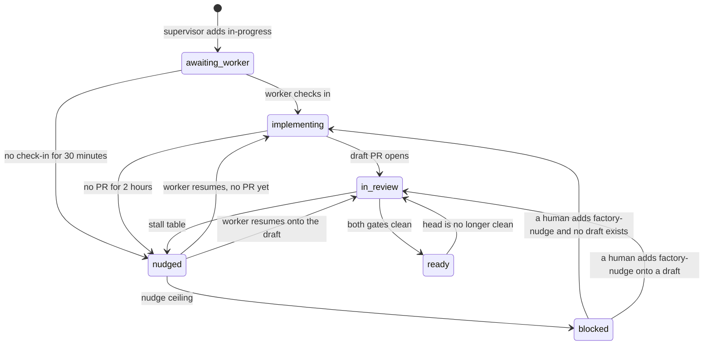

<!-- SPDX-License-Identifier: GPL-3.0-or-later -->
# Software factory

Cursor automations that turn triaged issues into draft pull requests for
`vcolombo/cuthulhu`. Humans paste the prompts below into
[cursor.com/automations](https://cursor.com/automations). This file is the
protocol they follow.

Two other docs stay in force beside it:

- `docs/agents/triage-labels.md` — what the triage labels mean. The factory
  consumes `ready-for-agent`. It does not triage.
- `AGENTS.md` — how a change is made and reviewed. The worker follows the
  PR review gates there. This file decides which issue is claimed and when a
  run is nudged. It does not replace those gates.

Labels are the source of truth for a claim. The GitHub Project is the board
humans read. A pull request stays a draft until a human merges it.

## Constants

| Name | Value | What it bounds |
| --- | --- | --- |
| `CAP` | 3 | Open issues labeled `in-progress`. Each one is a slot. |
| `NUDGE_CEILING` | 3 | Times the supervisor may fire `factory-nudge` on one claim. |
| Schedule | every 15 minutes (`*/15 * * * *`) | Supervisor only. A run may start a few minutes late. |
| Repo | `vcolombo/cuthulhu` | Both automations, and the thermo-nuclear review automation. |
| Project | title `cuthulhu`, owner `vcolombo` | The board. Missing project does not block a claim. |

`CAP` and `NUDGE_CEILING` are different knobs. Three slots may be in flight.
A single slot stops being nudged after three wakes and waits for a human.

## Board and labels

Create one GitHub Project titled `cuthulhu` under the `vcolombo` user before
the supervisor is turned on. Status is a single-select with exactly these
options, in this order: **Backlog**, **Ready**, **In Progress**, **Done**.

| Column | Meaning |
| --- | --- |
| Backlog | Open issue, neither ready nor claimed. |
| Ready | Label `ready-for-agent`, and no `in-progress` label. |
| In Progress | Label `in-progress`. |
| Done | Issue closed. |

Built-in project workflows ([Using the built-in automations](https://docs.github.com/en/issues/planning-and-tracking-with-projects/automating-your-project/using-the-built-in-automations)):

- **Item added to project** → Status `Backlog`.
- **Item closed** → Status `Done`.
- **Pull request merged** → Status `Done`.
- **Auto-add to project** from `vcolombo/cuthulhu`, filter `is:issue`.

GitHub has no built-in workflow that moves Status when a label is added. The
supervisor sets Status when it claims, releases, or reconciles. Humans apply
`ready-for-agent`; the next supervisor run moves that card to Ready.

### Checklist

- [ ] Project `cuthulhu` exists for owner `vcolombo`, with those four Status options.
- [ ] The three workflows above are on, plus auto-add for `is:issue`.
- [ ] Ready means `ready-for-agent`. In Progress means `in-progress`.
- [ ] `in-progress` exists. Description: `Factory claimed; a worker may/should be running`.
- [ ] `factory-nudge` exists. Description: `Supervisor asks the worker automation to resume this ticket`.
- [ ] `CAP` is 3. The supervisor never claims a fourth open `in-progress` issue.
- [ ] Cloud Agent secret `GH_TOKEN` is a Runtime Secret on the environment both automations use (see below).
- [ ] The thermo-nuclear automation includes the trigger **Pull request pushed**.
- [ ] Worker automation `cuthulhu-factory-worker` uses a **Webhook** trigger. It does not use Label Change.
- [ ] Repository secrets `CURSOR_FACTORY_WEBHOOK_URL` and `CURSOR_FACTORY_WEBHOOK_KEY` are set on `vcolombo/cuthulhu`.
- [ ] `.github/workflows/factory-worker-dispatch.yml` is on `main`.

`in-progress` and `factory-nudge` are workflow labels, same axis as the triage
set in `docs/agents/triage-labels.md`. They sit beside type and provenance
(`docs/issue-labels.md`). The factory does not add or remove a type label or a
provenance label. An issue keeps exactly one type.

### Never auto-pick

The supervisor claims an open issue that has `ready-for-agent` and has none of:

| Label | Why it stays out of the factory |
| --- | --- |
| `ready-for-human` | A person has to implement it (`docs/agents/triage-labels.md`). |
| `needs-triage` | A maintainer still has to evaluate it. |
| `needs-info` | The reporter still owes information. |
| `question` | Product decision. Type label, not a triage synonym for `needs-info` (`docs/agents/triage-labels.md`, `docs/issue-labels.md`). |
| `wontfix` | It will not be actioned. |

An exclusion label wins when it shares an issue with `ready-for-agent`. The
worker does not go looking for another issue. If the issue that woke it
carries one of these labels, it stops.

### `GH_TOKEN`

The token Cursor injects for a cloud agent is read-only on pull requests and
has no Issues access, so `gh issue list` and `gh issue edit` fail closed. Both
automations need a fine-grained PAT stored as a Cloud Agent secret:

- Name, exactly: `GH_TOKEN`. `gh` reads that name. `GITHUB_PAT` is invisible to it.
- Type: **Runtime Secret** (redacted from transcripts and commits).
- Repository `vcolombo/cuthulhu`: Issues read/write, Pull requests read/write, Metadata read.
- Account permission: Projects read/write, so Status on the user project can move.
- The automation's environment is the one that holds the secret. A saved "skip install" / no-environment fast start does not inject it. Re-select the environment and save.

Git pushes still use Cursor's app credential. The PAT is for `gh` and the
GitHub API. The token never goes in the prompt. A run that gets 403 on
`GET /repos/vcolombo/cuthulhu/issues` stops. It does not claim, nudge, or
report success.

### Thermo-nuclear trigger

The automation that runs the thermo-nuclear review — the repo skill
`.cursor/skills/thermo-nuclear-code-quality-review/SKILL.md`, the thermo
draft-review automation — must include **Pull request pushed**.

Also include **Draft opened**. The worker opens drafts. **Pull request
opened** fires when a non-draft PR is created or a draft is marked ready, so
a draft-only trigger set never reviews the first head. **Pull request
pushed** is the trigger that reviews each later head. `AGENTS.md` counts a
review only for the head it was made on, so a fix-up commit with no push
trigger has no review that counts.

That automation reviews. It does not implement, label, or merge.

### Worker dispatch

The Automations docs list **Issue label changed**. The Automations form
cannot set it: Label Change attaches to pull requests only. A worker
triggered that way never runs when the supervisor adds `in-progress` or
`factory-nudge` to an issue.

The worker automation is `cuthulhu-factory-worker`, and its trigger is
**Webhook**. Saving the automation shows a POST URL and an API key. Those
are repository Actions secrets on `vcolombo/cuthulhu`, not text in the
prompt:

| Secret | Value |
| --- | --- |
| `CURSOR_FACTORY_WEBHOOK_URL` | The webhook URL from the automation. |
| `CURSOR_FACTORY_WEBHOOK_KEY` | The API key alone. Not the words `Bearer`. |

`.github/workflows/factory-worker-dispatch.yml` listens for
`issues: [labeled]`. It POSTs only when the label is `in-progress` or
`factory-nudge`, the repository is `vcolombo/cuthulhu`, and the payload is
not a pull request (`issue.pull_request` is absent). The supervisor still
adds and removes the labels. The label add is what the workflow watches.
The supervisor does not call the webhook itself.

The request is `POST` with `Content-Type: application/json` and
`Authorization: Bearer <key>`. That is the header Cursor's webhook accepts
([Automations](https://cursor.com/docs/cloud-agent/automations), webhook
section: saving the trigger creates the URL and the API key). A 200 starts
a run. A trailing newline in the key makes the runner return 400 before
authentication, because the HTTP/2 client ends the header block at the
break. The workflow strips CR and LF. If the secret is the copied header
(`Bearer crsr_...`), the leading `Bearer ` is removed and the same header
is sent. A 401 means the key is stale: regenerate it on the automation
page, store the raw key in `CURSOR_FACTORY_WEBHOOK_KEY`, and add the label
again. The workflow log prints the JSON body and the HTTP status. It does
not print the URL or the key.

The `issues` event runs a workflow only from the default branch. This file
has to be on `main` before a label add can dispatch.

The body the worker reads:

```json
{
  "issue_number": 123,
  "issue_url": "https://api.github.com/repos/vcolombo/cuthulhu/issues/123",
  "html_url": "https://github.com/vcolombo/cuthulhu/issues/123",
  "label": "in-progress",
  "repo": "vcolombo/cuthulhu",
  "title": "the issue title"
}
```

`label` is `in-progress` or `factory-nudge`. `issue_url` is the API URL.
`html_url` is the issue in the browser.

#### Smoke test

Run this after the workflow is on `main`, the webhook trigger is saved, and
both repository secrets are set. It starts a real worker on that issue.

1. Pick an open issue you are willing to have implemented. If it already has `in-progress`, remove that label first. An existing label does not fire `labeled`.
2. Add `in-progress`.
3. In Actions, **Factory worker dispatch** for that issue ends with `webhook HTTP 200`. The log shows the payload and no URL or key.
4. `cuthulhu-factory-worker` has a new run whose body `issue_number` is that issue.

A 401 in that log is a key problem, not a label problem. Regenerate the
webhook API key, update `CURSOR_FACTORY_WEBHOOK_KEY` with the raw key, then
remove `in-progress` and add it again.

## `factory-meta`

Each claimed issue has one issue comment, edited in place, whose body is:

```text
factory-meta
<!-- factory-meta
{
  "worker_run": "",
  "pr_url": "",
  "branch": "",
  "followup_state": "awaiting_worker",
  "nudge_count": 0,
  "last_supervisor_at": "2026-10-29T04:45:00Z"
}
-->
```

The HTML comment is the record. The visible first line is `factory-meta` so
the comment is findable. The JSON is the only copy of the fields. Agents
locate the comment by the literal `<!-- factory-meta`, take the object
between that marker and `-->`, and PATCH that comment id. They do not put
this comment in the issue body. The body stays the specification.

A second comment that contains `<!-- factory-meta` is ignored for reading
after the oldest one. The supervisor rewrites the oldest and does not create
another.

| Key | Type | Who writes it | Empty |
| --- | --- | --- | --- |
| `worker_run` | string | Worker. URL of the Cursor run that owns the claim, or `run:<ISO-8601>` when the URL is unknown. | `""` until the worker checks in |
| `pr_url` | string | Worker. Draft pull request URL. | `""` until the draft exists |
| `branch` | string | Worker. Head branch name. | `""` until the branch exists |
| `followup_state` | string | Both, for the transitions below. | never empty once the comment exists |
| `nudge_count` | number | Supervisor. Increments only when `factory-nudge` is added or re-added. | `0` on a new claim |
| `last_supervisor_at` | string | Supervisor. UTC `YYYY-MM-DDTHH:MM:SSZ`. | set on every supervisor write |

Extra keys are preserved. Strings stay strings. `nudge_count` stays a number.
The worker preserves `nudge_count` and `last_supervisor_at`. The supervisor
preserves `worker_run`, `pr_url`, and `branch` except when it opens a new
claim, where all three reset to `""`.

`followup_state` is one of:

| State | Meaning |
| --- | --- |
| `awaiting_worker` | Claimed. The worker has not checked in. |
| `implementing` | Worker checked in. No draft URL yet. |
| `in_review` | Draft exists. The gates in `AGENTS.md` are not both clean on this head. |
| `nudged` | `factory-nudge` is on the issue. The worker should resume. |
| `blocked` | Stopped for a human. The supervisor does not nudge. The slot stays occupied until a human removes `in-progress`. |
| `ready` | Both gates are clean on the current head. The pull request is still a draft. A human merges. |



Invalid comment (JSON does not parse, a required key is missing, or
`followup_state` is outside the set): the supervisor rewrites a valid object,
copies any string `worker_run` / `pr_url` / `branch` it could read, keeps a
numeric `nudge_count` or else 0, sets `followup_state` to `blocked` and
`last_supervisor_at` to now, and posts one comment whose first line is
`factory-blocked: factory-meta comment did not parse`. It does not add
`factory-nudge`.

Stall comments are separate and visible. First line is exactly:

```text
factory-nudge: <one sentence>
```

or, when the factory gives the slot to a human:

```text
factory-blocked: <one sentence>
```

### When the supervisor adds `factory-nudge`

All of these are true first: the issue is open, it has `in-progress`, it has
no exclusion label, and `followup_state` is not `blocked` and not `ready`.

| Stall | Wait | Fire |
| --- | --- | --- |
| `awaiting_worker` and `worker_run` is `""` | 30 minutes since `last_supervisor_at` | Add `factory-nudge` once. |
| `implementing` and `pr_url` is `""` | 2 hours since the meta comment's `updated_at` | Add `factory-nudge` once. |
| `in_review`, CI on the current head has finished red, no later commit | 30 minutes since that failure | Add `factory-nudge` once. |
| `in_review`, a review on the current head has an unresolved thread or requested changes, no later commit | 30 minutes since that review | Add `factory-nudge` once. |
| `in_review`, head not clean, no commit and no meta edit | 4 hours | Add `factory-nudge` once. |
| `factory-nudge` already present, meta and the PR head both unchanged since the latest `factory-nudge:` comment, `nudge_count` below 3 | 4 hours | Remove the label and add it again. |
| Same, and `nudge_count` is already 3 | 4 hours | Remove `factory-nudge`. Set `blocked`. |

A row that says "Add `factory-nudge` once" requires `nudge_count` below
`NUDGE_CEILING` and requires the label to be absent. When that stall is
already true and `nudge_count` is 3, do not add the label: set
`followup_state` to `blocked` and post `factory-blocked: nudge ceiling reached`.

Adding the label, including a remove-and-add, increments `nudge_count` by 1
and sets `followup_state` to `nudged`. A label that is already present does
not dispatch: `factory-worker-dispatch.yml` runs on the `labeled` event,
which is the add. While the meta comment or the PR head has moved since the
latest `factory-nudge:` comment, the worker is in motion and the supervisor
leaves the label alone.

`ready` is not a stall. Red CI or a new unresolved thread on that head moves
`followup_state` back to `in_review`. The stall wait then applies. The
supervisor does not merge and does not mark the draft ready.

### Releasing a claim

On an open claimed issue, any exclusion label: remove `in-progress`, remove
`factory-nudge`, set `followup_state` to `blocked`, leave `pr_url` and
`branch`, set Status to `Backlog`. Do not close the pull request.

On a closed issue that still has `in-progress` or `factory-nudge`: remove
both labels. The closed workflow sets Status to `Done`. A closed issue does
not occupy a slot.

### Filling slots

```text
slots = CAP - (open issues with label in-progress)
```

Re-count immediately before each claim. Stop claiming at zero free slots.
Overlapping supervisor runs can briefly pass `CAP` by the number of overlaps.
The next run claims nothing until the open count is back under `CAP`. It does
not remove `in-progress` from work a worker has started.

Candidates: open issues labeled `ready-for-agent`, oldest `createdAt` first,
then lowest issue number. Drop any issue that has an exclusion label, already
has `in-progress`, or is referenced by an open pull request (`#<number>` as a
whole token in the title or body). Leave that issue in Ready for a human.

For each issue taken, in order, as two edits with a re-read between them:

1. `gh issue edit <n> --repo vcolombo/cuthulhu --remove-label ready-for-agent`
2. Re-read. If the issue is closed or now has an exclusion label, stop this claim.
3. `gh issue edit <n> --repo vcolombo/cuthulhu --add-label in-progress`
4. Write `factory-meta` with `followup_state` `awaiting_worker`, `nudge_count` 0, empty `worker_run` / `pr_url` / `branch`, and `last_supervisor_at` now.
5. Add the issue to project `cuthulhu` if it is absent, then set Status to `In Progress`.

Do not add `factory-nudge` in the same turn as a new `in-progress`. Each
added label dispatches the worker, and two dispatches start two branches.

Status commands, once the project number is known (`gh project list --owner vcolombo`):

```text
gh project item-add <number> --owner vcolombo --url https://github.com/vcolombo/cuthulhu/issues/<n>
gh project item-edit <number> --owner vcolombo --url https://github.com/vcolombo/cuthulhu/issues/<n> --field Status --value "In Progress"
```

Use `Ready`, `Backlog`, or `Done` the same way. A project API failure is
reported in the run summary. The label edit still stands.

Reconcile on every run, for issues the run already listed:

- Open, `in-progress` → Status `In Progress`.
- Open, `ready-for-agent`, no `in-progress`, no exclusion label → Status `Ready`.
- Open, on the project, neither label → Status `Backlog`.

## Supervisor prompt

Automation name: `cuthulhu factory supervisor`.

Trigger: schedule, every 15 minutes, cron `*/15 * * * *`. Repository
`vcolombo/cuthulhu` (a schedule defaults to no repository; set it anyway).
Environment: the one with the `GH_TOKEN` Runtime Secret. Memories off. The
run posts issue comments with `gh`. It does not open a pull request.

Paste the fenced text as the automation instructions.

```text
You are the cuthulhu factory supervisor for github.com/vcolombo/cuthulhu.
Read docs/agents/software-factory.md on origin/main and follow it. If this
prompt and that file disagree, the file wins.

You fill empty slots and you tend issues already labeled in-progress.
You never implement code. You never edit source, commit, push, open a pull
request, mark a draft ready, approve, or merge. You never apply
ready-for-agent. You never add or remove a type label or a provenance label.

Constants: CAP = 3. NUDGE_CEILING = 3. Project title "cuthulhu", owner
vcolombo. Repo vcolombo/cuthulhu.

Auth: gh api user and gh issue list must succeed against this repo. A 403
or a missing GH_TOKEN means you stop immediately and say so. You do not
fall back to the read-only app token. You do not print the token.

factory-meta: one issue comment per claim. Visible first line "factory-meta".
Then an HTML comment that starts with the literal "<!-- factory-meta" and
contains one JSON object with these keys, in this order: worker_run (string),
pr_url (string), branch (string), followup_state (string), nudge_count
(number), last_supervisor_at (UTC YYYY-MM-DDTHH:MM:SSZ). Edit that comment
in place. Do not write a second one. Do not store the object in the issue
body. Preserve extra keys. On a new claim, set worker_run, pr_url, and
branch to "" and nudge_count to 0. Otherwise preserve worker_run, pr_url,
and branch.

followup_state is only: awaiting_worker, implementing, in_review, nudged,
blocked, ready. If the comment is missing on an in-progress issue, create
it as awaiting_worker with empty worker_run, pr_url, and branch,
nudge_count 0, and last_supervisor_at now. If it does not parse or the
state is outside that set, rewrite a valid object, salvage string
worker_run / pr_url / branch, keep a numeric
nudge_count or else 0, set followup_state to blocked, set
last_supervisor_at to now, post one comment whose first line is
"factory-blocked: factory-meta comment did not parse", and do not nudge.

Never claim an issue that has any of: ready-for-human, needs-triage,
needs-info, question, wontfix. Those meanings are in
docs/agents/triage-labels.md. question is a product-decision type, not a
synonym of needs-info. An exclusion label wins over ready-for-agent.

Each run, in this order:

1. Closed issues that still have in-progress or factory-nudge: remove both
   labels. They do not count toward CAP.

2. Open in-progress issues that now have an exclusion label: remove
   in-progress and factory-nudge, set followup_state to blocked, keep
   pr_url and branch, set project Status to Backlog, post
   "factory-blocked: <which label>". Do not close the pull request.

3. Tend every remaining open in-progress issue. Read its factory-meta and
   its pull request. Apply the stall table in docs/agents/software-factory.md.
   Short version, all required before a nudge: open, in-progress, no
   exclusion label, state is not blocked and not ready. A new nudge also
   requires nudge_count below 3. If the stall is real and nudge_count is
   already 3, do not add the label: set blocked and post
   "factory-blocked: nudge ceiling reached".
   - awaiting_worker with empty worker_run for 30 minutes since
     last_supervisor_at, and no factory-nudge: add factory-nudge.
   - implementing with empty pr_url and meta unchanged for 2 hours, and no
     factory-nudge: add factory-nudge.
   - in_review and CI failed on the current head with no later commit, 30
     minutes after the failure: add factory-nudge.
   - in_review and the current head has an unresolved review thread or
     changes requested, no later commit, 30 minutes after that review: add
     factory-nudge.
   - in_review, head not clean, no commit and no meta edit for 4 hours: add
     factory-nudge.
   - factory-nudge already on, and neither the meta comment nor the PR head
     has changed since the latest comment that starts with "factory-nudge:",
     for 4 hours: if nudge_count < 3, remove the label and add it again; if
     nudge_count is already 3, remove the label, set blocked, and post
     "factory-blocked: nudge ceiling reached".
   A nudge increments nudge_count by 1, sets followup_state to nudged, sets
   last_supervisor_at to now, and posts a separate comment whose first line
   is "factory-nudge: <one sentence reason>". You only change labels. You do
   not POST the worker webhook. .github/workflows/factory-worker-dispatch.yml
   does that when in-progress or factory-nudge is added to an issue. A label
   that is already present does not dispatch; the stall table's remove-and-add
   is what wakes the worker again. If the meta comment or the PR head moved
   after that comment, the worker is in motion: leave the label.
   ready is not a stall. If that head is red or has a new unresolved thread,
   set followup_state back to in_review and let the wait run. Do not merge.
   Do not mark the draft ready for review.

4. Reconcile the project when it exists. Open + in-progress → Status
   "In Progress". Open + ready-for-agent, without in-progress, without an
   exclusion label → Status "Ready". Open on the project with neither label
   → Status "Backlog". Item-add before item-edit when the issue is not on
   the project yet. A project error does not roll back a label.

5. Fill slots. Re-count open in-progress issues before every claim. Free
   slots = 3 minus that count. Candidates are open ready-for-agent issues
   without an exclusion label and without in-progress, oldest createdAt
   first, then lowest number. Skip a candidate that an open pull request
   already references as a whole-token #<number> in the title or body. For each
   claim: remove ready-for-agent, re-read, abort that claim if the issue
   closed or gained an exclusion label, then add in-progress. Write
   factory-meta as awaiting_worker. Set Status to "In Progress". Do not add
   factory-nudge on a claim.

Finish with a run summary only: slots in use, slots free, issue numbers
claimed, issue numbers nudged, issue numbers blocked. No code, no token, no
new GitHub issue.
```

## Worker prompt

Automation name: `cuthulhu-factory-worker`.

Trigger: **Webhook**. Not Label Change, and not a pull-request label. The
Automations form cannot target issue labels. `.github/workflows/factory-worker-dispatch.yml`
POSTs when `in-progress` or `factory-nudge` is added to an issue. The
webhook body is the JSON in the Worker dispatch section (`issue_number`,
`issue_url`, `html_url`, `label`, `repo`, `title`).

Repository `vcolombo/cuthulhu`. Same `GH_TOKEN` environment. Memories off.
Pull request creation on. Comment on pull request on, so review threads can
be answered. The pull request this automation opens is a draft.

Paste the fenced text as the automation instructions.

```text
You are the cuthulhu factory worker for github.com/vcolombo/cuthulhu.
Read docs/agents/software-factory.md, AGENTS.md, docs/agents/triage-labels.md,
docs/issue-labels.md, and GLOSSARY.md on origin/main. If this prompt and
docs/agents/software-factory.md disagree about claiming or nudging, the file
wins. If this prompt and AGENTS.md disagree about how to change or review
code, AGENTS.md wins.

This run was started by a webhook. The JSON body has issue_number, issue_url,
html_url, label, repo, and title. repo is vcolombo/cuthulhu. label is
in-progress or factory-nudge. You implement exactly that issue_number. You
do not scan the board for other ready-for-agent work. You do not claim a
slot. You do not merge, you do not enable auto-merge, and you do not mark
the pull request ready for review. It stays a draft. You do not add or
remove a type label or a provenance label. You do not apply ready-for-agent.
You do not POST the webhook. GitHub Actions already did.

Auth: gh must be able to read and edit issues on vcolombo/cuthulhu. A 403
or a missing GH_TOKEN means you stop and say so. You do not print the token.

Read issue_number and label from the webhook JSON. If issue_number is
missing, or repo is not vcolombo/cuthulhu, stop without editing labels.
label in-progress is a fresh claim. label factory-nudge is a resume.

Read the issue, its labels, its comments, and the single factory-meta
comment (the one that contains "<!-- factory-meta"). The JSON keys are
worker_run, pr_url, branch, followup_state, nudge_count,
last_supervisor_at. You may update worker_run, pr_url, branch, and
followup_state. You preserve nudge_count and last_supervisor_at. You edit
the existing comment. You create it only when it is missing. followup_state
is only: awaiting_worker, implementing, in_review, nudged, blocked, ready.
Set worker_run to this run's Cursor URL, or to "run:<UTC timestamp>" when
you cannot read the URL.

If the issue has any of ready-for-human, needs-triage, needs-info, question,
or wontfix: do not implement. Post "factory-blocked: <which exclusion label>".
Set followup_state to blocked. If the webhook label is factory-nudge, remove
factory-nudge. Leave in-progress for the supervisor to release. Stop.

If the webhook label is factory-nudge and the issue has no in-progress
label: remove factory-nudge and stop. A nudge is not a claim.

If the webhook label is in-progress and factory-meta already has a
non-empty worker_run and followup_state is implementing, in_review, ready,
or blocked: stop. You are a duplicate wake. Do not open a second branch.
Exception: followup_state blocked is resumed only when the webhook label is
factory-nudge, which a human may add. The supervisor does not nudge a
blocked issue.

First write of a real wake, before other edits: set worker_run and set
followup_state to implementing (no pr_url yet) or leave in_review when
resuming a draft that already exists.

Fresh in-progress wake: fetch origin/main and branch from that tip. Branch
name cursor/<issue-number>-<short-slug>. Implement only what the issue asks.
Follow AGENTS.md: plan_cut stays the cut chokepoint, glossary words, SPDX
header on every new file, commit subjects imperative with the reason. Run
the tests the change needs from the Commands section. The three CI gates
there apply when you touch them: cargo test --workspace --locked and a
committed Cargo.lock when dependencies change; a rebuilt apps/desktop/ui/dist
when ui/src changes; a regenerated apps/desktop/ipc-inventory.json when a
Tauri command changes. A docs-only change needs none of those rebuilds.

Gate 1, before the pull request exists, from the PR review section of
AGENTS.md: in-harness review against git diff origin/main...HEAD. Never a
bare git diff. On any behavioural change, ask for the test-coverage reviewer
by name. Fix what holds up and re-run on the new head until a pass raises
nothing new. A reviewer that rewrites code is a fix, and the gate restarts.

Open one draft pull request into main. The body follows
.cursor/skills/pr/SKILL.md and includes a line "Fixes #<n>" so a later human
merge closes the issue. Name the gate-1 base and head in the body. If the
pull request was opened ready, convert it with gh pr ready <n> --undo before
you finish. Record pr_url and branch. Set followup_state to in_review.

Gate 2, after the draft exists: whichever review bots are installed,
including the thermo-nuclear automation. That automation is triggered on
Draft opened and on Pull request pushed, so a new commit gets a new review.
Triage every finding. Fix the valid ones, reply on each thread with the
commit or the reason, and re-request bots that only run when asked. A review
counts for a head only when it is attached to that head's sha. Do not block
the run waiting for a bot that has not reported. Do not wait on a bot that
is not installed; say that in the pull request body. When both gates are
clean on the current head, set followup_state to ready and stop. Leave the
draft. A human merges.

Nudge wake: if branch and pr_url are both empty, the previous worker never
started. Implement from origin/main the same way as a fresh in-progress wake.
If a branch or draft already exists, resume that branch and that pr_url. Do
not open a second pull request. Do not restart from an empty branch when
that branch exists. Address the reason in the latest comment whose first line is
"factory-nudge:". Push the fix to the same branch. When that reason is
handled on the current head (the failing check is fixed, the review thread
is answered, the missing gate step is done), remove factory-nudge with
gh issue edit <n> --repo vcolombo/cuthulhu --remove-label factory-nudge.
Update factory-meta to in_review, or to ready when both gates are clean.
Removing the label is how the supervisor knows the nudge was addressed.
Leave the label on when you could not address it, with worker_run updated,
so the supervisor can see you checked in.

When the issue needs a product decision or a human implementation and you
cannot proceed honestly: post "factory-blocked: <what a human must decide>",
set followup_state to blocked, remove factory-nudge if this was a nudge,
and stop. Do not code around the gap. Leave in-progress so the slot stays
occupied until a human removes it.

You never merge.
```

## Turn-on order

Do these in this order. Automation instructions are the fenced prompts.
Triggers are set in the form at
[cursor.com/automations](https://cursor.com/automations), not inside the
prompt. Save each automation before the next step.

1. **Labels and board.** Walk the checklist in this file. Confirm
   `in-progress` and `factory-nudge` carry the descriptions quoted above.
   Confirm the never-auto-pick labels exist. Create project `cuthulhu` and
   turn on its workflows. Add the open issues you want on the board; auto-add
   only catches later updates.
2. **`GH_TOKEN`.** Create the fine-grained PAT. Store it as a Runtime Secret
   named `GH_TOKEN` on the Cloud Agent environment. Re-select that
   environment on any automation that was saved with skip-install, then save,
   so the secret is actually injected.
3. **Thermo-nuclear automation.** Edit the existing thermo draft-review
   automation. Add **Pull request pushed**. Add **Draft opened** as well if
   the only open trigger is **Pull request opened**, because drafts do not
   fire that one. Save. Do this before any worker pull request exists, or
   the first draft has no review that counts.
4. **Worker webhook and repository secrets.** Automation name
   `cuthulhu-factory-worker`. Trigger **Webhook** only. Do not add Label
   Change. Paste the worker prompt. Repository `vcolombo/cuthulhu`.
   Environment with `GH_TOKEN`. Memories off. Save, then copy the webhook
   URL and the API key into the repository secrets
   `CURSOR_FACTORY_WEBHOOK_URL` and `CURSOR_FACTORY_WEBHOOK_KEY`. The key
   secret is the raw key. Turn the worker on while zero open issues are
   labeled `in-progress`. An idle webhook does not run.
5. **Dispatch workflow on `main`.** Merge
   `.github/workflows/factory-worker-dispatch.yml` to `main`. The `issues`
   event does not run a workflow that is only on a branch.
6. **Smoke test.** On an issue you are willing to have implemented, remove
   `in-progress` if it is already present, then add it. **Factory worker
   dispatch** prints `webhook HTTP 200`, and `cuthulhu-factory-worker`
   starts a run for that issue number. A 401 means regenerate the webhook
   key into `CURSOR_FACTORY_WEBHOOK_KEY` and add the label again.
7. **Supervisor.** Automation name `cuthulhu factory supervisor`. Paste the
   supervisor prompt. Schedule every 15 minutes. Same repository and
   environment. Memories off. Turn it on last, after the smoke test has
   shown that a label add reaches the worker.

A label added while the worker webhook is off, or while the dispatch
workflow is not yet on `main`, does not replay. Remove `in-progress`, put
`ready-for-agent` back when that issue should stay in Ready, and let the
supervisor claim it after step 6 has passed. Do not run the supervisor
before the smoke test.

Humans still triage, apply `ready-for-agent`, answer `factory-blocked`
comments, remove `in-progress` to free a blocked slot, and merge drafts
whose `followup_state` is `ready`. The factory does not merge.
